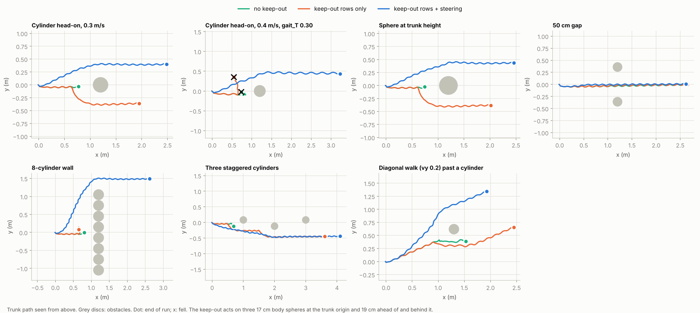

# Go1 torque-native locomotion: consensus-ADMM contact forces + Koopman legs

A torque-controlled Unitree Go1 in MuJoCo. Every 5 ms the stance legs agree on their contact
forces by consensus ADMM (layer 1), and each leg turns its share into joint torques (layer 2):
the Jacobian transpose in stance, a learned Koopman-operator MPC in swing. There is no planner,
no whole-body controller and no joint PD in the loop, and the total push and twist on the trunk
is never a target: it is whatever the agreed foot forces add up to.

## How it works

**Layer 1, foot forces** (`controller/dist_horizon.py`, body `dhmpc`, the default). Each tick looks
160 ms ahead in 8 steps of 20 ms. The gait clock says which feet are down at each step, and feet
due to land are predicted to advance with the command until their touchdown. The forces for every
(foot, step) solve

```
min   sum_k 1/2 ||x_k - x_ref||^2_Q  +  lam/2 sum_{i,k} ||f_ik - f_nom||^2
s.t.  |f_x|, |f_y| <= 0.7 f_z,   0 <= f_z <= m g,   f_ik = 0 while foot i is in the air
```

where x_k is the trunk's linear and angular velocity predicted by single-rigid-body dynamics
(world frame), Q = diag(400, 400, 400, 30, 30, 15), lam = 0.005 and f_nom = (0, 0, mg/4). Height,
attitude and heading enter through x_ref: the commanded velocity plus a pull back to 27 cm, to
level, and to the integrated turn command.

ADMM splits the problem into one tiny subproblem per (foot, step), each solved exactly by
checking the 19 active-set cases of its friction pyramid, plus one 6N x 6N linear solve for the
correction the feet share at each step, plus scaled duals that price the mismatch. Every iterate
is feasible and the fixed point is the exact optimum. The controller runs 8 iterations per tick,
starting from the previous tick's solution aligned by contact pattern, and applies the first
step's forces. The `dist` body (`controller/dist_wrench.py`) is the same negotiation for the current
instant only.

**Layer 2, torques** (`controller/koopman_admm.py`). Stance: tau = bias - J^T R^T f. Swing: a
Raibert foothold from the measured speed with a 6 cm clearance arc, inverse kinematics, then a
6-step MPC per leg (qpax, float32, motor limits 23.7 / 23.7 / 35.55 N m) on a learned lifted
model z+ = A z + B tau with 17 features z = [q, qd, sin q, cos q, sin(q2+q3), cos(q2+q3), qd^2].
A and B are fit by ridge regression on 9,000 transitions of randomized, torque-excited swing
motion with the trunk pinned in the air.

## Files

```
model/scene_flat.xml        scene the simulator loads (floor + robot)
model/go1.xml               Unitree Go1 with torque motors
model/assets/               the five meshes go1.xml loads
model/LICENSE               license of the Go1 model and meshes (BSD-3-Clause, Unitree Robotics)
common/torque_sim.py        MuJoCo wrapper: joint torques in, state out, optional viewer
common/leg_kinematics.py    leg forward kinematics and Jacobian
controller/koopman_admm.py  Koopman legs, operator fitting, run() closed loop, command line
controller/dist_horizon.py  layer 1, horizon form (dhmpc, the default)
controller/dist_wrench.py   layer 1, instantaneous form (dist) and the exact per-leg force solver
controller/jumps.py         jumping: crouch, push, flight and landing on top of layer 1
MATH.md                     the formulation: costs, constraints, keep-out, ADMM, steering, Koopman legs
tests/                      pytest checks of the keep-out (fast) and closed-loop runs (--runslow)
experiments/                obstacle scenarios, convergence, solve-time benchmark, figures, videos
docs/figures/               figures the Obstacles section shows (made by experiments/plot_results.py)
```

`model/`, `common/` and `controller/` must stay side by side: the code finds the model and the
shared modules by relative path. The first run fits the leg operators once, deterministically,
and caches them in `controller/leg_ops.npz`.

## Setup

Tested with Python 3.12, mujoco 3.14, jax 0.11.2 (CPU), qpax 0.1.4 and numpy 2.4.

```
pip install -r requirements.txt
pip install -r requirements-dev.txt     # tests and experiments: pytest, matplotlib, pillow
```

The obstacle keep-out, the tests and the experiments were run with Python 3.13, mujoco 3.15,
jax 0.11.2 (CPU), qpax 0.1.4 and numpy 2.5.

## Running

From `controller/`:

```
python koopman_admm.py                            # trot in place for 6 s, horizon body
VX=0.3 SECONDS=10 VIEW=1 python koopman_admm.py   # walk, in the viewer
VX=0.4 GAIT_T=0.30 python koopman_admm.py         # long strides
MODE=stand BODY=dist python koopman_admm.py
```

## Commands

### What a command is

The robot is driven by three velocity commands: `vx` and `vy` (m/s), forward and leftward in
the robot's current heading frame, and `wz` (rad/s), the yaw rate, positive counterclockwise.
Every tick the forward and lateral commands are rotated into world axes with the measured
heading. The turn command is not tracked as a rate: it is integrated into a heading reference,
and the controller tracks that heading with integral action, so rotation lost to slip is made
up. Height (27 cm) and a level trunk are held automatically and are not commands. Velocity
commands are meant for `trot`; in `stand` all four feet stay planted. In the swing footholds,
stride length follows the measured forward speed, lateral stride the commanded `vy`, and `wz`
rotates the footholds.

Commands are constants or functions of time, given either as environment variables to
`koopman_admm.py` or as keyword arguments to `run()` from Python.

### Command line: `koopman_admm.py`

| Variable | Meaning | Default |
|---|---|---|
| `MODE` | `stand` or `trot` | `trot` |
| `BODY` | `dhmpc` (horizon) or `dist` (instantaneous) | `dhmpc` |
| `VX`, `VY` | forward and leftward speed (m/s) | 0 |
| `WZ` | yaw rate (rad/s) | 0 |
| `SECONDS` | run length (s) | 6 |
| `GAIT_T` | trot half-period (s): each diagonal pair stands for `GAIT_T` | 0.10 |
| `PUSH` | shove on the trunk (N): world-frame force (PUSH, PUSH/2, 0) from t = 1.00 to 1.15 s | 0 |
| `ITERS` | ADMM iterations per tick for `dist` | 30 |
| `VIEW`, `VIEW_SPEED` | `VIEW=1` opens the viewer; `VIEW_SPEED` scales playback | off, 1.0 |
| `OBST` | obstacles, `;`-separated: `x,y,r` a vertical cylinder, `x,y,z,r` a sphere (m), added to the scene and kept out (see Obstacles) | none |
| `STEER` | `STEER=0` keeps the obstacles out without steering around them | 1 |

The flight phase, contact gating and the capture gain are set from Python.

### Python: `run()`

```python
import koopman_admm as KA                     # from controller/; puts ../common on the path
from torque_sim import TorqueSim
legs = KA.learn_operators()
log, upright = KA.run(TorqueSim(), legs, "trot", seconds=5, vx=0.3)
```

For time-varying commands pass functions of t, the time in seconds since the controller
started; they are evaluated every tick:

```python
vx = lambda t: min(0.1*t, 0.3) if t < 8 else 0.0   # ramp to 0.3 m/s over 3 s, stop at 8 s
wz = lambda t: 0.3 if 4 <= t < 6 else 0.0          # turn for 2 s
log, upright = KA.run(TorqueSim(), legs, "trot", seconds=10, vx=vx, wz=wz)
```

For live input, have the functions read a shared value. The viewer calls `key_callback` with
the GLFW key code of every key press:

```python
cmd = {"vx": 0.0}
def on_key(code):                                  # 265 = Up, 264 = Down
    if code in (265, 264):
        cmd["vx"] = min(max(cmd["vx"] + (0.05 if code == 265 else -0.05), -0.20), 0.45)
sim = TorqueSim(view=True, key_callback=on_key)    # needs a display
KA.run(sim, legs, "trot", seconds=600, vx=lambda t: cmd["vx"])
```

| Keyword | Meaning | Default |
|---|---|---|
| `mode` | `"stand"` or `"trot"` | `"stand"` |
| `seconds` | run length (s) | 10 |
| `vx`, `vy`, `wz` | commands: numbers or functions of t | 0 |
| `body` | `"dhmpc"` or `"dist"` | `"dhmpc"` |
| `gait_T` | trot half-period (s); stride length scales with it | 0.10 |
| `duty` | stance fraction of each half-period; below 1 adds a flight phase | 1.0 |
| `contact_gate` | force only to feet in sensed contact; late feet reach down, early feet join | False |
| `k_cap` | foothold capture gain; 0 disables capture | 0.10 |
| `push` | shove (N), as `PUSH` | 0 |
| `iters` | ADMM iterations per tick for `dist` | 30 |
| `stop` | function polled every tick; returning True ends the run | None |
| `verbose` | print a one-line summary | True |
| `obstacles` | list of `(x, y, r)` cylinders and `(x, y, z, r)` spheres to keep out (dhmpc only) | None |
| `steer` | bend the walking direction around the obstacles | True |

Horizon settings live in `KA.DHMPC_CFG = {"N": 8, "dt": 0.020, "iters": 8, "tol": 0.0}`: steps,
step length (s), ADMM iterations per tick, and an early-stop tolerance (`tol > 0` ends a tick's
iterations once no part of the iterate moves more than `tol`). The returned log holds, per tick,
roll, pitch and yaw (deg), height `z` (m), yaw rate `wz` (rad/s), world-frame x velocity `vx`
(m/s) and the full `qpos`; `upright` is False if the trunk dropped below 12 cm.

### What the commands reach

At the default half-period the trot shuffles with 3 cm steps and realizes about 70% of a
0.3 m/s forward command on dhmpc; for speed, lengthen the period: `GAIT_T=0.30` carries a
0.40 m/s command at 0.44 m/s for 10 s, and `duty=0.8` adds a flight phase at 0.44 m/s. A
0.3 rad/s turn is tracked fully, and strafing realizes 55 to 60% of a 0.2 m/s command.

## Obstacles

```
OBST="1.2,0,0.15" VX=0.3 GAIT_T=0.25 SECONDS=9 VIEW=1 python koopman_admm.py
```

```python
obst = [(1.2, 0.0, 0.15), (2.0, 0.4, 0.32, 0.18)]       # a cylinder and a sphere at trunk height
log, upright = KA.run(TorqueSim(obstacles=obst), legs, "trot", seconds=9, vx=0.3, gait_T=0.25, obstacles=obst)
```

`TorqueSim(obstacles=...)` adds the obstacles as solid geoms; `run(obstacles=...)` keeps them out.
The trunk is covered by three body spheres (`KA.KEEPOUT_CFG["bodies"]`, radius 17 cm, at the trunk
origin and 19 cm ahead of and behind it), and every step k of the dhmpc horizon gets, per obstacle
and body sphere, the constraint

```
r_obs + r_b - || p_k + R_k b - c || + h_k <= 0          (cylinders: xy distance only)
```

the circle keep-out of GPU-SLS (Fang and Chou, arXiv 2604.07644). To carry it, the horizon also
predicts trunk position and attitude, p_{k+1} = p_k + dt (v_k + v_{k+1})/2, exact for the
piecewise-constant wrench. Each constraint is linearized at the previous tick's predicted pose,
so it is the tangent half-space, which is inside the safe set whatever the linearization point (for
the body-sphere centres; the rotation of the spheres with roll and pitch is linearized about level,
and the 2 cm margin covers the rest). The heading is held at its predicted value in the rows: given
the heading as a free variable, the plan turned the trunk to creep closer to a wall it was held at
and fell.

h_k is the GPU-SLS tightening (`get_betas`, `get_constraint_tightenings`): the sum over steps of
the 2-norm of the row's response to a per-step wrench disturbance of 20 N and 3 N m, for the
open-loop response, since only the first step's forces are applied before the next solve; 2 cm
is added on top.

In the ADMM each linearized row gets a scalar copy, updated in the same block as the per-foot
force solves, so it stays two-block ADMM with the same fixed point as the constrained QP; the shared
solve becomes `((QW + C' Rc C) Nk + rho I) d = (QW + C' Rc C) A + qW + C' Rc (nu - y_r)`, y_r the
over-relaxed row copies (MATH.md). Forces stay
inside the friction pyramid at every iterate; the keep-out holds at convergence, and the rows are
soft (exact penalty) so the solve stays defined if one cannot be met. Rows more than 30 cm clear of
their tube, and the step-0 rows (2 to 6 mm of authority), are left out. Without obstacles the
controller is bit-for-bit unchanged.

The rows only keep the trunk out; on their own they stop the robot at the obstacle or slide it
sideways, and at 0.4 m/s with long strides the slide and release tipped it over. Steering bends the
commanded walking direction: of 49 headings within 69 degrees of the command, it takes the closest
one (with hysteresis) along which the trunk, its body axis set by the commanded walking direction
and swept 0.8 m along the heading, clears every obstacle by 6 cm, turning at up to 0.8 rad/s; with
no heading clear it takes the least-blocked one. It is a reference shaper, not a planner: a dead end
still traps it, and the rows then hold the robot in front of the obstacle.

In simulation (trot, gait_T 0.25 unless noted, rows plus steering), the robot passed a head-on
cylinder at 0.3 m/s and at 0.4 m/s (gait_T 0.30), a sphere at trunk height, a 50 cm gap, three staggered cylinders,
a diagonal walk (vy 0.2) past a cylinder and the end of an 8-cylinder wall without touching them,
with 4.9 to 7.3 cm clearance; without the keep-out it hit the obstacles in every scenario but the
gap. Rows alone held the robot in front of the wall. The rows add about 14% to the force solve with
one obstacle and 29% with 42 rows active. In random
trials at 0.4 m/s and short gait periods with turning, a few runs fell after passing the obstacle,
with the rows inactive; the gait falls at those settings without obstacles too.



`docs/figures/` also holds the clearance over time (`02`), the controller's internals in the head-on
run (`03`: heading offset, active rows, row multipliers, planned against realized clearance), the ADMM
error against an exact QP solve with the tightening per step (`04`) and the solve-time cost (`05`).

## Tests and experiments

From the repository root:

```
pytest tests                    # keep-out against an independent dense QP, steering geometry, obstacle geoms
pytest tests --runslow          # also: no-obstacle runs bit-identical to the controller before the
                                # keep-out (taken from git), and every obstacle scenario in MuJoCo
```

From `experiments/` (outputs go to `results/`, which git ignores):

```
python scenarios.py             # every scenario x {none, rows, rows+steer} -> results/scenarios/*.npz
python convergence.py           # ADMM error against the dense QP versus iterations
python bench_solve.py           # layer-1 solve time with and without obstacles, against the old code
python plot_results.py --out ../docs/figures      # the five figures and a results table
MUJOCO_GL=egl python record_video.py headon rows+steer    # mp4 of one run (needs ffmpeg)
```

## Results

Tilt is the peak |roll| or |pitch| over the run; speed is displacement over duration, startup
included. 4 s runs at trot half-period 0.10 s unless noted; timings on one CPU core.

| Motion | Command | dist | dhmpc |
|---|---|---|---|
| Stand | | 0.35° | 0.35° |
| Trot | 0.2 m/s | 0.15 m/s @ 2.16° | 0.13 m/s @ 0.67° |
| Trot | 0.3 m/s | 0.25 m/s @ 3.20° | 0.21 m/s @ 0.95° |
| Trot, T = 0.25 s, 6 s | 0.30 m/s | 0.27 m/s @ 2.63° | 0.29 m/s @ 1.43° |
| Trot, T = 0.30 s, 6 s | 0.35 m/s | 0.36 m/s @ 5.13° | 0.36 m/s @ 1.62° |
| Trot, T = 0.30 s, 10 s | 0.40 m/s | | 0.44 m/s @ 2.04° |
| Flying trot, T = 0.30 s, duty 0.8, 10 s | 0.45 m/s | | 0.44 m/s @ 3.12° |
| Turn, 12 s | 0.3 rad/s | 100% @ 0.97° | 100% @ 0.35° |
| Strafe | 0.2 m/s | 0.12 m/s @ 2.33° | 0.11 m/s @ 0.70° |
| Force solve per tick (mean / p99) | | 0.90 / 1.21 ms | 0.89 / 1.14 ms |

## Robustness and limits

In simulated stress tests (trot 0.2 m/s, perturbations unknown to the controller) both bodies
stayed up under 5 and 10 ms actuation delay, 2x estimator noise, +2 kg payload, friction 0.4 and
80 N pushes; the worst tilt was 3.4° for dhmpc and 4.7° for dist, both at 2x noise. Rough ground
is the open problem: on five 1 cm bump layouts the instantaneous body with contact gating held
all five (3° to 5°), while the horizon body exceeded 35° on three of five with or without gating.
Two of five 2 cm layouts defeated both bodies.

## Design notes

- **One frame.** Everything is rotated into world axes, because grasp-map moments are
  world-frame; mixing frames made the posture loop fall over standing at 135° and 180° headings.
  Both bodies are heading-independent: from initial headings of 0° to 180°, standing tilt is
  0.35° throughout and trotting tilt varies by at most 0.05° (dhmpc) and 0.21° (dist).
- **Exact subproblems.** A clipped closed-form force update stalls 1.41 N from the optimum
  whenever the normal-force cap binds, while its consensus residual still vanishes.
- **Aggregate update order.** The shared solve is `(QW Nk + rho I) d = QW A + qW`; the reversed
  product converges 56 to 81 N off when stance counts differ across the horizon.
- **Footholds from measured speed.** Placing from the commanded speed brakes the trunk and
  collapses the gait above 0.3 m/s. The capture gain stays at 0.10: the LIP value 0.166 breaks
  long strides (1.9° to 43° at T = 0.30 s, 0.36 m/s). Without capture (`k_cap = 0`) a 0.15 m/s
  strafe rolls over within 4 s.
- **Predicted contact geometry.** Predicting touchdowns at the Raibert target misses the
  realized footholds by 5 to 8 cm and destabilizes long strides; freezing the feet goes stale
  past about 100 ms.
- **Horizon length.** 80 ms slowly diverges above a 0.36 m/s long-stride command, 320 ms is
  stable but tracks about 80% of the command, and 160 ms sustains the top speeds.
- **Iterations per tick.** 8 warm-started iterations reproduce the 40-iteration results within
  0.01 m/s and 0.1° on every cell above, at 0.89 ms instead of 1.64 ms per tick.
- **Warm start by contact pattern.** Starting a step from its own old index is best away from
  contact switches, and from the next old step at them. On 300 captured problems the alignment
  keeps both: after 8 iterations the gap to the exact solution is 0.76 N in median and 8.7 N at
  worst, against 13.9 N at worst from the same index.
- **Torque-aware force caps.** Capping each foot's normal force by its joint-torque limits
  starved transient support (1.9° to 30°). The speed ceiling is leg capability: at 0.45 m/s and
  full duty the stance thighs need 1.4x their torque limit before clipping.
- **Operator data.** Densifying the swing excitation (periods 0.15 to 0.8 s, sweeps up to
  26 cm) cut the dist long-stride tilt from 20° to 5°.
- **Leg QPs in float32,** the precision the operators were identified and the gaits validated
  at.

## Model

The Go1 model is adapted from the Unitree Go1 (`unitree_go1`) in
[MuJoCo Menagerie](https://github.com/google-deepmind/mujoco_menagerie), released by Unitree
Robotics under the BSD-3-Clause license kept in `model/LICENSE`. The meshes are unchanged; the
position servos are replaced by torque motors at the Go1's limits (23.7, 23.7 and 35.55 N m),
the friction cone is pyramidal instead of elliptic, and default contacts carry tangential
friction (condim 3).
